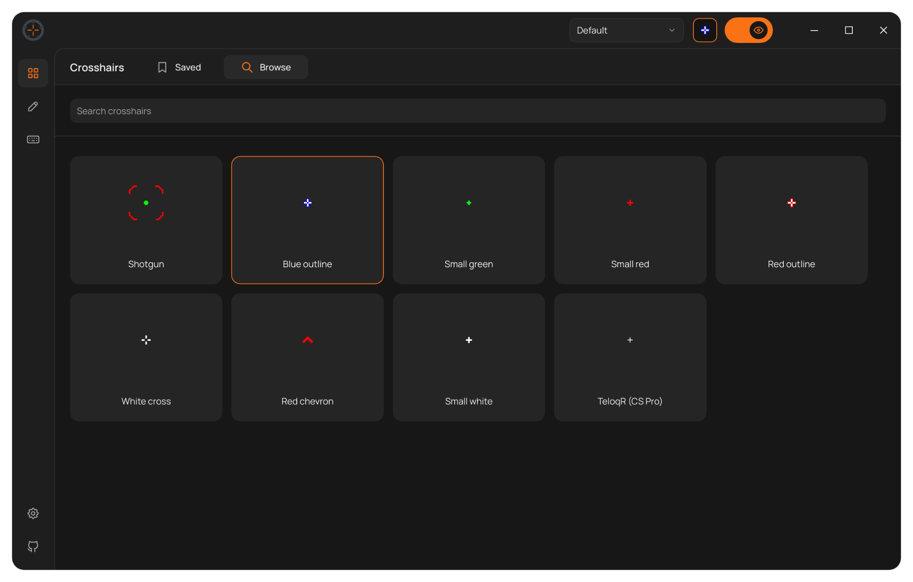
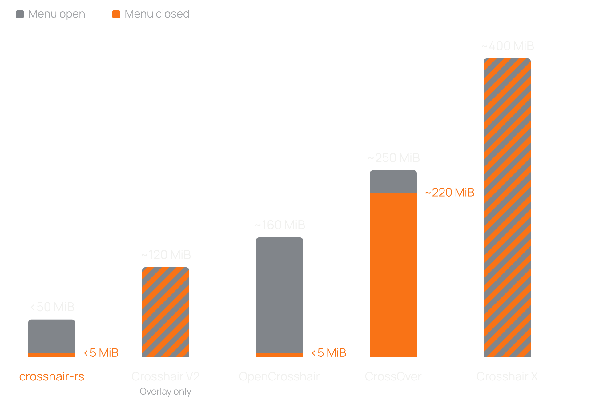
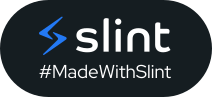

  

<h1 align="center">crosshair-rs</h1>

A lightweight, customizable crosshair overlay for Windows.

  
  
  

Create layered crosshairs, save presets and switch them with keyboard or mouse
shortcuts. Close the editor to leave the overlay running.

## Get started

Windows 11, x64. See [Releases](https://github.com/ohne-b/crosshair-rs/releases)
and the [installation guide](docs/installation.md).

[Documentation](docs/README.md) covers the editor, shortcuts, Game Bar and troubleshooting.
Fullscreen compatibility depends on Xbox Game Bar and the game.

## RAM usage

## Contributing

See [CONTRIBUTING.md](docs/CONTRIBUTING.md) for building, testing and pull requests.
[Report a bug](https://github.com/ohne-b/crosshair-rs/issues) with your version and steps to reproduce it.

## License and credits

[GPLv3 with a Game Bar SDK linking exception](LICENSE.md). Third-party licenses and credits are in [NOTICE.md](NOTICE.md).

Logo adapted from the [Rust logo](https://github.com/rust-lang/rust-artwork/blob/main/logo/rust-logo-gear-only.svg),
owned by the Rust Foundation, under [CC BY 4.0](https://creativecommons.org/licenses/by/4.0/).
Colors and symbol modified.

<a href="https://slint.dev/">
  <picture>
    <source media="(prefers-color-scheme: dark)" srcset="assets/MadeWithSlint-dark.svg">
    
  </picture>
</a>
